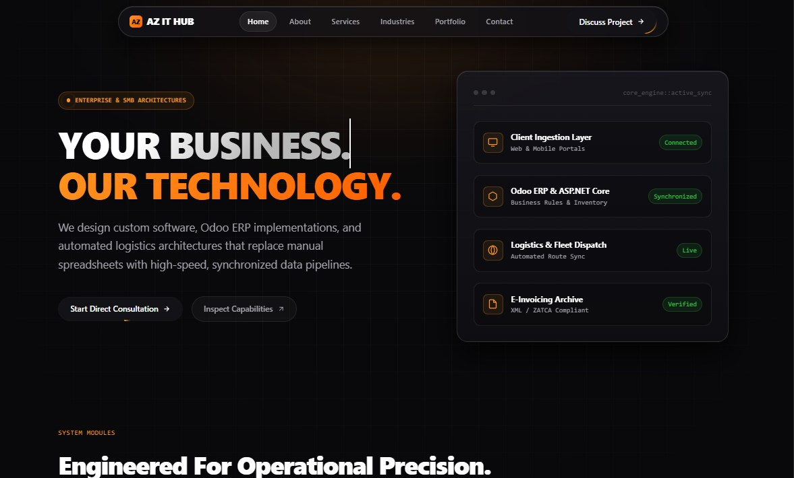

# AZ IT HUB — Enterprise Digital Platform & Engineering Showcase

[](https://osmanbinabubakar.github.io/)
[](https://osmanbinabubakar.github.io/)
[](https://linkedin.com/in/osman-bin-abubakar)
[](https://osmanbinabubakar.github.io/contact.html)

> **"YOUR BUSINESS. OUR TECHNOLOGY."**  
> Official source repository and technical architecture for **AZ IT HUB**, founded and engineered by **Osman Bin Abubakar**.

---

<p align="center">
  <a href="https://osmanbinabubakar.github.io/">
    
  </a>
</p>

---

## 🌐 Live Production URL

The platform is compiled, secured, and served globally via GitHub's edge network:  
👉 **[https://osmanbinabubakar.github.io/](https://osmanbinabubakar.github.io/)**

---

## 💼 Career & Professional Engagements (Open for Roles)

Osman Bin Abubakar is open to **high-impact technical roles**, **international remote employment**, and **strategic consulting contracts**:

### Target Roles & Scopes
- **Senior Software Engineer / Backend Engineer** (`C# / ASP.NET Core`, `Python`, `Node.js`)
- **ERP & Odoo Solutions Architect** (Custom Module Engineering, Inventory, Accounting & Invoicing Workflows)
- **Full-Stack Application Engineer** (`React`, `TypeScript`, `Next.js`, `PostgreSQL`)
- **Technical Lead / System Integrator** (Process Automation, E-Invoicing Compliance, Dispatch Platforms)

### Engagement Models
- **Full-Time Remote Employment:** Available for GCC, European, and global technology organizations.
- **Enterprise Contracts:** Direct system architecture, Odoo customizations, and operational modernizations.
- **Consulting & Advisory:** Technical feasibility assessments, database modeling, and workflow automation.

---

## 🎯 Executive Overview

**AZ IT HUB** is an independent technology and digital solutions brand engineered to help commercial enterprises modernize legacy systems, implement tailored ERP workflows, automate manual operations, and deploy resilient web and mobile platforms.

This repository serves two primary objectives:
1. **Professional Services Brand:** Presenting end-to-end technical capabilities across ERP implementation, custom software engineering, logistics dispatch architectures, and fiscal compliance.
2. **Founder Engineering Showcase:** Demonstrating verified technical competencies, architecture case implementations, and backend engineering methodologies under the leadership of Software Engineer **Osman Bin Abubakar**.

---

## 🛠️ Technology Stack & Core Competencies

### Languages & Frameworks
- **Backend:** C# (.NET / ASP.NET Core), Python, Node.js, Express.js, RESTful APIs
- **Enterprise Platforms:** Odoo ERP (v15, v16, v17), Custom Module Development, Odoo ORM
- **Frontend & Interfaces:** TypeScript, React, Next.js, Semantic HTML5, Modern CSS3
- **Mobile Development:** React Native, Flutter

### Databases & Infrastructure
- **Databases:** PostgreSQL, MongoDB, SQL Server
- **Architecture:** Monolithic & Microservice APIs, Relational Normalization, Webhooks, Message Queuing
- **Hosting Strategy:** Zero-cost, high-reliability static edge deployment via GitHub Pages

### Operational Focus Areas
- **Mobility & Dispatch:** Chauffeur coordination, driver shifts, trip auditing, automated billing rates
- **Inventory & Supply:** Odoo multi-warehouse routing, safety-stock rules, batch/serial tracking
- **Compliance & Fiscal:** ZATCA-compliant E-Invoicing, schema-validated XML pipelines, audit trail logging
- **Automation:** Automated ledger synchronization, scheduled cron jobs, exception queues

---

## 🏗️ Architectural Model: Headless Data-Driven Static Engine

To eliminate runtime server dependencies, subscription costs, and cold-start latency while maintaining complete separation of concerns, this platform runs on a **Headless Static JSON Architecture**.

```text
osmanbinabubakar.github.io/
├── index.html              # Presentation Shell (Home & Live System Visualizer)
├── about.html              # Executive Profile, Manifesto & Pillars
├── services.html           # Technical Service Specifications & Scopes
├── industries.html         # Domain Solutions & Industry Workflows
├── portfolio.html          # Verified Architecture Case Studies
├── contact.html            # Direct Channels & Client Inquiry Compiler
├── robots.txt              # Search Engine Indexing Directives
├── sitemap.xml             # Canonical Search Index Mapping
├── assets/
│   ├── css/
│   │   └── style.css       # High-Fidelity Design System (Bento / Aurora / Spotlight)
│   ├── js/
│   │   ├── script.js       # UI Controllers (Pointer Spotlight, Drawer Traps, Year Sync)
│   │   └── render.js       # Asynchronous Data Hydrator with Strict XSS Sanitization
│   └── images/
│       └── hero-preview.png # Live Platform Visual Reference
└── data/                   # Headless JSON Content Store (Single Source of Truth)
    ├── profile.json        # Founder Metadata, Stack Tags & Contact Channels
    ├── services.json       # Bento Capabilities & Responsive Spans
    ├── portfolio.json      # Technical Case Implementations & Tags
    └── industries.json     # Commercial Verticals & Automation Models

---

### Key Technical Properties:
- **Zero-Dependency Core:** 100% native HTML5, modern CSS3, and vanilla JavaScript. No framework bloat, build steps, or npm vulnerabilities.
- **Hardware-Accelerated UI:** Dynamic mouse-coordinate calculation (`--mouse-x`, `--mouse-y`) drives real-time radial border illumination across all Bento cards.
- **Strict Security & XSS Mitigation:** The hydration script (`render.js`) executes strict-mode input encoding on all dynamic fields before inserting into the DOM.
- **Client-Side Intent Compiler:** `contact.html` formats complex client specifications and directly interfaces with client-side mail agents and WhatsApp protocols without third-party form storage or server-side logging.

---

## 📝 Content Management Protocol

To update site information without altering HTML structures, edit the corresponding file in `/data/`:

| File | Contains |
|---|---|
| `data/profile.json` | Founder bio, executive statement, tech stack chips, email, phone, and social handles |
| `data/services.json` | Service definitions, capability chips, module numbers, and Bento column spans (`4`, `6`, `8`) |
| `data/portfolio.json` | Architectural case studies, status badges, operational descriptions, and technology tags |
| `data/industries.json` | Supported commercial sectors, operational problems addressed, and workflow solutions |

---

## 📬 Direct Engineering Channels

Direct consultations, architecture scoping, and employment discussions are handled without intermediaries:

- **Founder & Lead Engineer:** Osman Bin Abubakar
- **Direct Mail:** [osmanalhasnoon@gmail.com](mailto:osmanalhasnoon@gmail.com)
- **WhatsApp & Mobile:** [+91 97005 33269](https://wa.me/919700533269)
- **LinkedIn:** [linkedin.com/in/osman-bin-abubakar](https://linkedin.com/in/osman-bin-abubakar)
- **GitHub:** [github.com/osmanbinabubakar](https://github.com/osmanbinabubakar)

---

## 📄 License & Attribution

Copyright © 2026 AZ IT HUB — Osman Bin Abubakar. All rights reserved.  
Source code is maintained as an open engineering reference under the repository's native GitHub structure.
